# Care-Beacon Medical RAG System

A production Retrieval-Augmented Generation (RAG) system that answers patient questions about cancer from articles published by BC Cancer, the Canadian Cancer Society and Cleveland Clinic. Every answer cites the source paragraphs it was built from.

It offers two ways to ask:

- **Chat** (default): a multi-turn conversation with memory. Follow-up questions such as "What does that involve?" are rewritten into standalone searches, answers stream token by token, and every conversation is saved so it can be reopened later.
- **Search**: a single question with a single cited answer, cached in Redis.

**Live:** https://care-beacon-health.vercel.app

**Companion repository:** [Vital-Atlas](https://github.com/kamlau024/Vital-Atlas) is the
upstream scraper that produces this system's corpus. Care-Beacon consumes Markdown and
serves answers; it does no crawling of its own. See
[Where the corpus comes from](#where-the-corpus-comes-from).

## Highlights

- **Conversational RAG with memory.** Follow-up questions are rewritten using the conversation, retrieval runs on the rewritten query, and the answer is generated with a character-budgeted history. Threads and messages persist in Postgres (Neon).
- **Streaming on serverless.** `POST /api/v1/chat` streams Server-Sent Events from a Python function on Vercel: progress stages (`rewriting` → `searching` → `ranking`), then citations, then answer tokens. The answer is saved even when the client disconnects mid-stream; a partial answer is stored as `interrupted`.
- **Measured, not assumed.** A Langfuse evaluation harness with LLM judges gates each release. The latest gate: **19/19** safety refusals in multi-turn drift threads, **0.88** follow-up resolution, **0.96** grounded answers, about **$0.0007 per chat turn** ([results](evaluation/results/2026-11-12-phase1-gate.md)).
- **Cost and abuse controls.** A daily LLM spend cap ($2/day by default), counted in Redis across all OpenAI calls; a per-IP rate limit at the Vercel firewall; admin endpoints behind an API key.
- **Privacy by design.** No accounts: each browser holds an anonymous owner key, and traces carry only its SHA-256 pseudonym. Clients get generic error messages, and logs record only the error type, never database error text.
- **Tested end to end.** 407 API tests, 41 web tests and 32 evaluation-tooling tests, run in GitHub Actions on every push and pull request.

## Architecture

<a href="https://care-beacon-health.vercel.app/diagrams/architecture.html">
<picture>
  <source media="(prefers-color-scheme: dark)" srcset="docs/diagrams/architecture.dark.svg">
  
</picture>
</a>

<sub>Click the diagram to open the interactive version: zoom, search, and links to the source code.</sub>

- **Two Vercel services behind one route table:** `/api/*` goes to the FastAPI `api` service; everything else goes to the Next.js `web` service.
- **Cited answers:** the answer generator checks Redis first, then retrieves passages from Qdrant Cloud and writes the answer with OpenAI `gpt-4o-mini`.
- **Conversation storage:** chat threads and messages live in Neon Postgres, reached through its pooled connection string. Migrations are plain SQL files in `api/migrations/`.
- **Observability:** optional Langfuse tracing records each step of a turn (rewrite, search, rerank, generation) with token cost.
- **Offline ingestion:** `api/scripts/ingest.py` runs on a local machine and loads the [Vital-Atlas](https://github.com/kamlau024/Vital-Atlas) corpus into Qdrant. The deployed API has no ingestion endpoints.

### How a question is answered

<a href="https://care-beacon-health.vercel.app/diagrams/ask-sequence.html">
<picture>
  <source media="(prefers-color-scheme: dark)" srcset="docs/diagrams/ask-sequence.dark.svg">
  
</picture>
</a>

<sub>Click the diagram to open the interactive version: zoom, search, and links to the source code.</sub>

1. **Cache check.** Redis is keyed on a SHA-256 hash of the normalized question, filters, and limits. A hit returns immediately, with no OpenAI calls.
2. **Wide retrieval.** On a miss, the question is embedded with `text-embedding-3-small` (1536 dimensions) and Qdrant returns 6× the requested number of chunks.
3. **Rerank and filter.** A loose pre-filter keeps scores ≥ 0.3, `gpt-4o-mini` reranks every remaining candidate, and every chunk scoring ≥ 0.6 is kept, with no top-k cut. (0.6 is the configured default; a request can set its own `min_similarity`.)
4. **Generate and cache.** `gpt-4o-mini` writes an answer with paragraph-level citations, cached for 1 hour. If no chunk passes the threshold, a fixed "no context" reply is returned without an LLM call, and it isn't cached.

### How a chat turn is answered

Chat reuses the same retrieval and reranking as Search, with three additions: query rewriting, conversation history and streaming.

<a href="https://care-beacon-health.vercel.app/diagrams/chat-sequence.html">
<picture>
  <source media="(prefers-color-scheme: dark)" srcset="docs/diagrams/chat-sequence.dark.svg">
  
</picture>
</a>

<sub>Click the diagram to open the interactive version: zoom, search, and links to the source code.</sub>

1. **Rewrite.** On a follow-up, `gpt-4o-mini` turns the last few turns plus the new message into one standalone search query, so "Does it reach cells all over the body?" searches for the treatment being discussed. The rewritten query is shown to the user as the search runs.
2. **Retrieve and rerank.** The query goes through the same embed → Qdrant → LLM rerank pipeline as Search, filtered by the thread's own source and similarity settings.
3. **Generate with history.** The most recent turns that fit a 6,000-character budget are included, with old `[n]` citation markers stripped so they can't be confused with this turn's sources. Safety instructions are placed next to the question, where they hold up under multi-turn pressure.
4. **Persist.** The user's message is saved before retrieval starts and the answer, with its citations and cost, once it completes. Changing a thread's settings adds a settings event to the conversation and applies to later turns only.

Each diagram opens in an interactive viewer hosted on the live site, where you can zoom, search, focus on a component, and follow it to the source lines it was drawn from. The diagram sources live in [`docs/diagrams/`](docs/diagrams/).

## Project Status

**Current Version**: 4.0.0 - **Live in Production** (Vercel)

### Build history

- **Phase 1: Foundation** - Complete
  - Markdown parser with YAML frontmatter
  - Document chunking and embeddings
  - Data models and storage layer

- **Phase 2: Core RAG System** - Complete
  - Vector database integration (Qdrant Cloud)
  - Retrieval engine with semantic search
  - LLM integration (OpenAI GPT-4o-mini)
  - Answer generation with citations
  - Redis caching layer (Upstash, via Vercel Marketplace)

- **Phase 3: Production Deployment** - Complete
  - Deployed on Vercel as two Services (`api` + `web`) behind one route table
  - FastAPI REST API (OpenAPI docs served only in debug mode)
  - Source filtering (BC Cancer / Canadian Cancer Society / Cleveland Clinic)
  - Rate limiting via Vercel WAF, error handling
  - Modern FastAPI lifespan pattern, Pydantic v2 compliant

- **Phase 4: Conversational Chat** - Complete
  - Streaming chat endpoint (SSE) with query rewriting and conversation memory
  - Thread history in Neon Postgres: list, rename, delete, per-thread retrieval settings
  - Chat page as the default view: history drawer, settings popover, citation chips, streamed progress
  - Daily spend cap, pseudonymous Langfuse tracing, evaluation harness with a release gate
  - Search now filters by any combination of sources; per-role model configuration

### Quality Metrics

| Metric | Status |
|--------|--------|
| **Test suite** | API: 407 passing, 14 skipped (Postgres tests, which need `TEST_DATABASE_URL`); web: 41 passing (Vitest); evaluation tooling: 32 passing. CI runs the API and web suites, the TypeScript check and a production build on every push and pull request. |
| **Safety** | 19/19 refusal-and-referral passes in multi-turn drift threads; 19/19 in the single-turn control |
| **Answer quality** | Chat: 0.88 follow-ups resolved, 0.96 grounded. Search baseline: 0.744 grounded |
| **Latency** | Chat turn: 12.5 s median, 19.8 s worst on the follow-up set. Most of it is spent before the first token (rewrite, search, rerank) |
| **Cost** | About $0.0007 per chat turn (median of 128 traced turns) |

Quality, safety, latency and cost figures come from the 2026-11-12 evaluation gate, described in [`evaluation/results/2026-11-12-phase1-gate.md`](evaluation/results/2026-11-12-phase1-gate.md).

Run `make test` for the current state on your machine.

## Documentation

Comprehensive documentation is available:

- **[API Documentation](docs/API.md)** - Complete REST API reference with examples, including the chat SSE frame contract
- **[Evaluation](evaluation/README.md)** - How the Langfuse datasets, judges and experiment runs work
- **[Developer Guide](docs/DEVELOPER_GUIDE.md)** - Setup, testing, and development workflow
- **[Usage Examples](docs/USAGE_EXAMPLES.md)** - Tutorials and integration patterns
- **[Performance Optimization](docs/PERFORMANCE_OPTIMIZATION.md)** - Monitoring, benchmarking, and optimization guide
- **[Architecture](docs/ARCHITECTURE.md)** - System design and component overview
- **Interactive API Docs** - Swagger UI at `/docs`, served by the FastAPI app only when `api.debug` is `true` in `api/config/config.yaml` (off in production)
- **[Project Plan](Claude.md)** - Original requirements and design decisions

## Features

- **Intelligent Question Answering** - AI-powered responses with paragraph-level citations
- **Multi-Source Support** - BC Cancer, Canadian Cancer Society, and Cleveland Clinic content
- **Source Filtering** - Filter by any combination of the three sources
- **Conversational Chat** - Multi-turn chat with follow-up questions, streamed answers (SSE) and visible progress stages
- **Conversation History** - Threads saved in Postgres (Neon), with auto-generated titles, rename and delete, and no sign-up required
- **Per-Thread Settings** - Choose sources and a similarity threshold per conversation; changes are logged in the transcript and apply to later turns
- **Smart Caching** - Redis (Upstash) caching to reduce repeated LLM/embedding costs
- **Vector Search** - Semantic similarity using OpenAI embeddings and Qdrant Cloud
- **Citation Transparency** - Every claim linked to original source paragraph
- **Usage Statistics** - Live cost, cache and query counters on the Statistics page
- **Evaluation and Tracing** - Langfuse traces per turn and LLM-judged experiment runs
- **Spend Protection** - Daily LLM budget cap enforced on chat
- **REST API** - Modern FastAPI with OpenAPI documentation
- **Vercel Native** - Two Services (`api` + `web`) behind one route table, one domain

## Project Structure

```
care-beacon/
├── api/                      # FastAPI service (Vercel Service: api)
│   ├── src/
│   │   ├── ingestion/       # Article parsing and ingestion
│   │   ├── embeddings/      # Embedding generation and chunking
│   │   ├── storage/         # Vector DB (Qdrant) and cache (Redis)
│   │   ├── retrieval/       # Search and retrieval
│   │   ├── generation/      # LLM integration and prompts
│   │   ├── caching/         # Query result caching and usage counters
│   │   ├── chat/            # Chat service, prompt and history, SSE, spend cap, thread repository
│   │   ├── db/              # Postgres connection
│   │   ├── observability/   # Optional Langfuse tracing
│   │   └── api/             # REST API endpoints (FastAPI app)
│   ├── migrations/           # SQL migrations (make migrate)
│   ├── tests/                # Test suite
│   ├── scripts/              # Ingestion entrypoint (local only)
│   ├── config/                # config.yaml, prompts.yaml, prompts_chat.yaml
│   └── requirements.txt       # Runtime deps only (10 packages)
├── web-client/                # Next.js frontend (Vercel Service: web)
│   ├── components/chat/      # Chat page, transcript, history drawer, settings popover
│   └── lib/                  # API clients, SSE parser, owner key, citation rendering
├── scraped_data/               # Source markdown articles (never bundled into api/)
├── evaluation/                 # Langfuse datasets, judges, experiment runner, results
├── .github/workflows/test.yml  # CI: API and web tests on push and pull request
├── docs/                       # Documentation
├── vercel.json                  # Service routing table
└── .vercelignore                 # Filesystem upload exclusions (load-bearing, see Deployment)
```

## Installation

<details>
<summary>Prerequisites, environment setup, and verification</summary>

### Prerequisites

- **Python 3.10.19** (via Conda) - for local API development and tests; Vercel itself runs the `api` service on Python 3.12
- Node.js - for `web-client` (Next.js 16)
- [Vercel CLI](https://vercel.com/docs/cli) - for `vercel dev` and deployments
- OpenAI API key (embeddings + LLM)
- Qdrant Cloud instance (vector database)
- Neon Postgres database (chat history); provisioned through the Vercel Marketplace

### Step 1: Clone and Set Up the Python Environment

```bash
git clone https://github.com/kamlau024/Care-Beacon.git
cd Care-Beacon

conda create -n care-beacon python=3.10.19 -y
conda activate care-beacon
python -m pip install -r api/requirements.txt -r api/requirements-dev.txt
```

### Step 2: Configure Environment Variables

```bash
cp .env.example .env
# Fill in OPENAI_API_KEY, QDRANT_URL, QDRANT_API_KEY, ADMIN_API_KEY
```

`REDIS_URL` and `DATABASE_URL` are injected automatically by the Upstash Redis and
Neon Marketplace integrations when running on Vercel; for local work, pull them with
`vercel env pull`. Then create the chat tables:

```bash
make migrate
```

### Step 3: Verify Installation

```bash
make test
```

See [Deployment](#deployment) below for how the app runs in production, and
`docs/DEVELOPER_GUIDE.md` for a full local development walkthrough.

</details>

## Quick Start

### Production

The app is live at **https://care-beacon-health.vercel.app**. It opens on the Chat
page; Search and Statistics are in the top navigation.

```bash
# Check health
curl https://care-beacon-health.vercel.app/api/health

# Ask a question
curl -X POST "https://care-beacon-health.vercel.app/api/v1/ask" \
  -H "Content-Type: application/json" \
  -d '{"question": "What are the symptoms of breast cancer?"}'

# Start a chat (streams Server-Sent Events; -N disables buffering)
curl -N -X POST "https://care-beacon-health.vercel.app/api/v1/chat" \
  -H "Content-Type: application/json" \
  -H "X-Owner-Key: $(uuidgen | tr 'A-Z' 'a-z')" \
  -d '{"message": "What are common side effects of chemotherapy?"}'
```

### Local Development

```bash
# Set up environment (see Installation above), then:
vercel dev
```

`vercel dev` runs both Services (`api` and `web`) behind the same route table used
in production, so `/api/*` and everything else resolve exactly as they do live.
Under `vercel dev` the API reads `.env`, not `.env.local`, so `DATABASE_URL` must be in
`.env` or exported in your shell for chat to reach Postgres.

## Usage Examples

<details>
<summary>Python client and cURL examples</summary>

### Python Client

```python
import requests

# Ask a question
response = requests.post(
    "https://care-beacon-health.vercel.app/api/v1/ask",
    json={
        "question": "What are the symptoms of breast cancer?",
        "cancer_type": "Breast Cancer",
        "source": "BC Cancer"
    }
)

result = response.json()
print(f"Answer: {result['answer']}")
print(f"Sources: {len(result['sources'])}")
print(f"Cost: ${result['metadata']['cost']:.6f}")
```

### cURL

```bash
# Basic question
curl -X POST "https://care-beacon-health.vercel.app/api/v1/ask" \
  -H "Content-Type: application/json" \
  -d '{
    "question": "What is chemotherapy?",
    "max_results": 5
  }'

# With filters
curl -X POST "https://care-beacon-health.vercel.app/api/v1/ask" \
  -H "Content-Type: application/json" \
  -d '{
    "question": "What are treatment options?",
    "cancer_type": "Lung Cancer",
    "source": "BC Cancer"
  }'

# Get statistics
curl "https://care-beacon-health.vercel.app/api/v1/stats"
```

For more examples, see [Usage Examples](docs/USAGE_EXAMPLES.md).

</details>

## Testing

```bash
conda activate care-beacon
export PY="$CONDA_PREFIX/bin/python"

# Run all tests
cd api && $PY -m pytest tests/ -q --continue-on-collection-errors

# Postgres tests (skipped unless TEST_DATABASE_URL is set)
make test-db

# Web client tests (Vitest)
cd web-client && npm test

# Evaluation tooling tests
$PY -m pytest evaluation/langfuse/ -q

# Run a specific test file
cd api && $PY -m pytest tests/test_api.py -v

# Run with coverage
cd api && $PY -m pytest tests/ --cov=src --cov-report=term-missing
```

A bare `pytest` may resolve to a different interpreter (e.g. an Anaconda base
environment) and fail; use the `care-beacon` conda env's Python explicitly, or
`make test`, which does this for you.

**Current state** (2026-11-12): API 407 passed, 14 skipped (Postgres tests), 0 failed;
web 41 passed; evaluation tooling 32 passed. `make test-db` runs the Postgres tests in an
isolated schema and refuses to run outside it.

## Evaluation

Answer quality is measured, not eyeballed. `evaluation/langfuse/` holds versioned
datasets, LLM judges (`gpt-4o-mini` at temperature 0) and an experiment runner that
drives the real API, Search or Chat, and posts every score to Langfuse.

| Dataset | What it checks |
|---|---|
| Search baseline (78 questions) | Is the single-shot answer grounded in its sources? |
| Follow-ups (25 threads) | Does the answer to a vague follow-up address what the user meant, and stay grounded? |
| Safety (19 threads of 2, 3 and 5 turns) | Does the assistant still refuse personal medical decisions and refer the user to a clinician when a conversation drifts from general information to "what should I do"? |
| Safety control (19 single turns) | The same final questions asked cold, to show whether the conversation weakens refusals |

Safety is a hard gate: every item must pass before release. The current results and
the three follow-ups that still miss are written up in
[`evaluation/results/`](evaluation/results/).

## Deployment

One Vercel project (`care-beacon-health`), two Services, one domain:

| Service | Root | Framework | Public paths |
|---------|------|-----------|--------------|
| `web`   | `web-client/` | Next.js 16 | everything not under `/api/` |
| `api`   | `api/`        | FastAPI, Python 3.12 | `/api/*` |

Routing is defined in `vercel.json`. The `/api/(.*)` rewrite must stay ahead of the
`/(.*)` catch-all, because rewrites are evaluated in order and routing into a service
is final.

**Environment variables:** `OPENAI_API_KEY`, `QDRANT_URL`, `QDRANT_API_KEY`,
`ADMIN_API_KEY`, `VECTOR_DB_PROVIDER=qdrant`. `REDIS_URL` and `DATABASE_URL` are
injected by the Upstash Redis and Neon Marketplace integrations. Langfuse tracing turns
on only when `LANGFUSE_PUBLIC_KEY`, `LANGFUSE_SECRET_KEY` and `LANGFUSE_HOST` are all set.

**Function duration:** the `api` service allows 60 seconds per request
(`maxDuration` in `vercel.json`), about 3× the slowest measured chat turn.

**Local development:** `vercel dev` runs both services behind the same route table as
production. `make test` runs the Python suite.

**Ingestion is local-only:** `make ingest`. It reads `scraped_data/` — which lives
outside `api/` and is never bundled into the function — and upserts into Qdrant Cloud.

**Rate limiting** is enforced by the Vercel WAF, not application code: one custom rule
(`api-rate-limit`) allows 20 requests per 60 seconds per IP, counted together across
`/api/v1/ask` and `/api/v1/chat`, and returns 429 past that. It is managed with
`vercel firewall rules`.

**Spend cap:** every OpenAI call adds its cost to a per-UTC-day counter in Redis. Once
the day's total reaches `chat.daily_spend_cap_usd` ($2.00 by default), chat returns 429
until midnight UTC. Search keeps working, so the cheaper, cached path stays available.

**The upload, not just the deploy, is filesystem-based:** `vercel deploy` uploads
from disk, not from git, so `.gitignore` has no effect on it. `.vercelignore` keeps
`scraped_data/` (25,000+ files) and other local-only content out of the upload —
without it, the upload exceeds Vercel's 15,000-file limit. Do not delete it.

**Admin endpoints** (`POST /api/v1/cache/clear`, `POST /api/v1/stats/reset`) require
an `X-API-Key` header matching `ADMIN_API_KEY`.

## Configuration

Main configuration is in `api/config/config.yaml`. Key settings:

- **Embeddings**: Model, batch size, dimensions
- **Vector DB**: Qdrant collection name, distance metric
- **Retrieval**: Top-k results, similarity threshold
- **LLM**: Model selection, temperature, max tokens
- **Cache**: Redis settings, TTL
- **Costs**: API cost tracking
- **Chat**: daily spend cap (`chat.daily_spend_cap_usd`)

The LLM model is set per role (`llm.models`: generation, rerank, utility for rewriting
and titles), so a stronger model can be used for answers without paying for it on
every rerank. Prompts are in `prompts.yaml` (Search) and `prompts_chat.yaml` (Chat).

## Keepalive

Qdrant Cloud reclaims idle free-tier clusters after roughly a week of inactivity.
A Vercel cron job issues a daily GET to `/api/health`, which performs a real Qdrant
collection read — so a 200 proves the cluster answered, not merely that the function
booted.

It is configured in `vercel.json` and needs no secrets, no repository variables and
no external service:

```json
"crons": [{ "path": "/api/health", "schedule": "0 9 * * *" }]
```

**Three things to know:**

1. **The schedule is UTC**, always. `0 9 * * *` is 09:00 UTC.
2. **Hobby runs cron once per day, with up to 59 minutes of jitter.** That is ample
   here — Qdrant's idle threshold is about a week, so a daily ping has six days of
   margin. Per-minute scheduling would require Pro.
3. **Cron requests are identifiable**: Vercel sends them with the user agent
   `vercel-cron/1.0` and an `x-vercel-cron-schedule` header.

Check runs under Project → Cron Jobs in the Vercel dashboard, or with
`vercel crons ls`.

A GitHub Actions workflow was used for this originally. It was replaced while this
repository was still private, when Actions runs consumed the account's minutes quota —
and once that quota was exhausted, jobs sat queued forever with no runner assigned
and no error. A keepalive whose own failure mode is silent is worse than none.


## Data Source

- **Sources**: BC Cancer (bccancer.bc.ca), Canadian Cancer Society, Cleveland Clinic
- **Topics**: Various cancer types (breast, lung, digestive, etc.)
- **Format**: Markdown with YAML frontmatter
- **Location**: `scraped_data/` (gitignored — the corpus is not part of this repository)

### Where the corpus comes from

Care-Beacon does not scrape. Acquisition lives in a separate repository,
**[Vital-Atlas](https://github.com/kamlau024/Vital-Atlas)** — a Scrapy + Playwright
crawler with one spider per source that converts each article to clean Markdown with
YAML frontmatter. Together the two repositories form one pipeline:

<a href="https://care-beacon-health.vercel.app/diagrams/corpus-pipeline.html">
<picture>
  <source media="(prefers-color-scheme: dark)" srcset="docs/diagrams/corpus-pipeline.dark.svg">
  
</picture>
</a>

<sub>Click the diagram to open the interactive version: zoom, search, and links to the source code.</sub>

The contract between them is just the Markdown file and its frontmatter schema. That
boundary is why this repository could change hosts, swap its vector store, and drop a
272 MB keyword index without the scraper being touched.

**The hand-off is manual.** Vital-Atlas writes to its own `scraped_data/`; those files
are copied into this repository and then ingested with `make ingest`. Nothing
reconciles the two sides, so the corpora can drift — neither repository can detect
articles the other has not seen, and Qdrant can only report what it holds, never what
it is missing.

## Development

<details>
<summary>Daily workflow, Makefile commands, and code formatting</summary>

### Daily Development Workflow

```bash
# 1. Activate conda environment
conda activate care-beacon

# 2. Run both services locally
vercel dev

# 3. Run tests or develop
make test
```

### Makefile Commands

```bash
make test               # Run all tests
make test-cov           # Run tests with coverage
make lint                # Run linting (flake8 + mypy)
make format             # Format code with Black
make check               # Run tests + linting
make dev                 # Run both services via vercel dev
make ingest               # Run article ingestion (local only)
make migrate              # Apply SQL migrations to Postgres
make test-db              # Run Postgres tests in an isolated schema
make clean-cache        # Clear Python cache
make clean-logs          # Clear log files
make help                 # Show all commands
```

### Code Formatting

```bash
cd api
black src/ tests/
flake8 src/ tests/
mypy src/
```

</details>

## Cost

Measured from Langfuse traces of 128 chat turns (2026-11-12):

- **Per chat turn:** median $0.00071, max $0.00119. That covers query rewriting,
  embedding, reranking and the streamed answer, all on `gpt-4o-mini`.
- **Daily cap:** at the default $2.00/day the app allows roughly 2,800 median chat turns
  a day, shared with Search.
- **Search:** repeated questions are served from the Redis cache at no LLM cost.

The original planning estimates for other models (Claude, GPT-4o) are kept in
[`Claude.md`](Claude.md) for comparison.

## License

[MIT](LICENSE)

## Contact

Built by Kam — [github.com/kamlau024](https://github.com/kamlau024).

---

**Last Updated**: 2026-11-12
**Version**: 4.0.0 (Live in production on Vercel)
