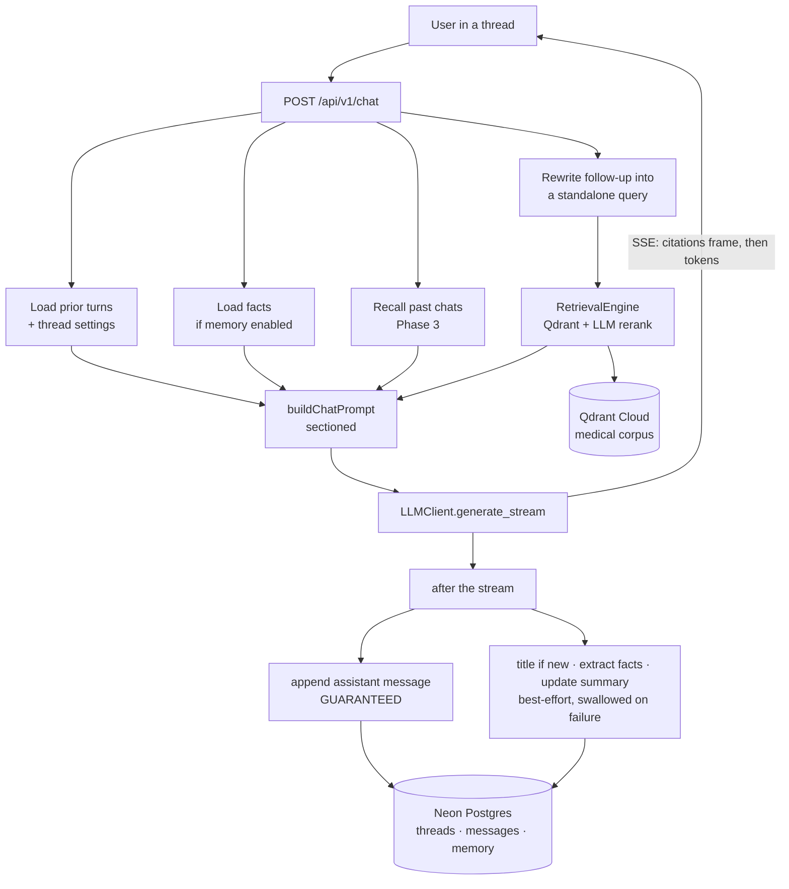

---
claude_sessions:
  - "2026-11-02 · Chat UX upgrade · claude://claude.ai/epitaxy/local_5d471c4c-0a7f-42f1-9630-695d8199821b"
---

# Care-Beacon: Conversational Chat with Memory

**Date:** 2026-11-02
**Status:** Approved by the owner 2026-11-11; pending implementation plans (one per phase)

## Intent

Care-Beacon answers one question at a time and forgets it immediately. A patient who
reads an answer about radiation side effects and then wants to know how long the fatigue
lasts has to retype the whole question, because nothing in the system knows what "the
fatigue" refers to. The goal is a chat experience: a thread the user can follow, come back
to, and read back later.

This project is explicitly **experimental and for learning**. That decision is on the
record because it shapes the privacy posture (see [Privacy](#privacy-and-medical-safety)):
the system will extract and store durable facts about the user from conversations about
cancer, which in a production patient-facing product would demand a compliance review this
project is not doing. The mitigation is user control, not avoidance — every stored fact is
visible, editable and deletable, and extraction can be switched off.

The reference implementation is the author's own [GoldenRetriever](https://github.com/kamlau024/GoldenRetriever)
project, which solved this problem for a personal knowledge base. Its design — a sectioned
prompt where memory is context but never a citable source, three independently shippable
memory phases, and citations carried out-of-band from the token stream — transfers to
Care-Beacon nearly intact. Where this document departs from it, it says so and why.

## Goals

1. **Multi-turn continuity.** Follow-ups that depend on earlier turns resolve correctly.
2. **Readable history.** Conversations persist, are auto-titled, and can be reopened,
   renamed and deleted.
3. **Retrieval controls inside the chat.** The source filter and similarity threshold that
   today sit in the search card remain available, without occupying the composer.
4. **An auditable transcript.** A reader of an old thread can see what retrieval settings
   each answer was produced under.
5. **Long-term memory.** Durable facts about the user, and recall of relevant past
   conversations — both under the user's control.
6. **Citation integrity preserved.** Multi-turn must not weaken the grounding guarantee.

## Non-goals

- **Authentication and user accounts.** Out of scope. Conversation ownership uses an
  anonymous browser-generated identifier (see [Identity](#identity)).
- **Replacing Qdrant.** The medical corpus stays where it is. See
  [Why Qdrant stays](#why-qdrant-stays).
- **Hybrid retrieval.** Adding Postgres makes dense+sparse+RRF retrieval possible, which is
  a genuine quality win for exact medical terms. It is a separate project; see
  [Deferred](#deferred).
- **Re-answering prior turns after a settings change.** A settings change is a boundary
  affecting later turns only.
- **Removing the Search page.** Search and its navigation item stay, unchanged, until Chat
  is complete and has demonstrably replaced them. Explicit user requirement.

## Anti-goals

These would make the project a failure even if every feature worked:

- **An answer that cites memory.** If the model ever presents a stored fact, a prior turn,
  or a recalled conversation summary as though it were sourced from the medical corpus, the
  system is worse than the one it replaced. Grounding is the product.
- **A memory failure that breaks a reply.** Fact extraction, titling and summarisation are
  conveniences. If any of them can fail a user's answer, the design is wrong.
- **Conversational drift into medical advice.** A thread that builds rapport over several
  turns makes "so what should I do?" feel more answerable than it does in one-shot Q&A. The
  refusal and disclaimer behaviour must survive multi-turn, not erode across it.
- **Cached answers leaking between conversations.** See [Caching](#caching).

## Current system

Relevant facts about what exists today, all verified against the code:

- `POST /api/v1/ask` is stateless: `QuestionRequest` → `QuestionResponse`, no conversation
  identifier anywhere in `api/src/api/models.py`.
- `AnswerGenerator.generate_answer(question: str)` uses that one string for three distinct
  jobs — the Redis cache key, the embedding for vector search, and the LLM user prompt.
- `LLMClient.generate(system_prompt, user_prompt)` builds a fixed two-message array. There
  is no way to pass prior turns.
- Nothing streams. `client.chat.completions.create` blocks and FastAPI returns a complete
  JSON body.
- The web client holds exactly one result (`result: QuestionResponse | null` in
  `web-client/app/page.tsx`), replaced on each search.
- Citations are linkified by regex over `[Source: Title - Section]` markers, fuzzy-matched
  against article titles (`parseCitations` in `web-client/components/search-interface.tsx`).
- Retrieval controls (three source checkboxes, a minimum-similarity slider) live in the
  search card.
- `api/config/prompts_eval.yaml` already contains an unused `followup_prompt_template`
  (`prompts.yaml` is a symlink to that file).
- Rate limiting is a Vercel WAF rule scoped to the path `/api/v1/ask`.
- **There is no `.github/` directory in this repository.** The daily `/api/health` ping is the
  `crons` entry in `vercel.json`, not a GitHub Actions workflow. CLAUDE.md's reference to
  `.github/workflows/keepalive.yml` is stale and should be corrected. Nothing automated
  enforces the test baseline — it is a local command only.
- **A 2-of-3 source selection is not currently expressible.** `QuestionRequest.source` is
  `Optional[str]`; `search-interface.tsx` sends it only when exactly one box is checked, so
  two of three silently searches all three; and `qdrant_db.py` builds only
  `FieldCondition(match=MatchValue(...))` — single-value exact match, with no `MatchAny`, so
  OR-over-sources is unsupported at the storage layer too. See
  [open decision 1](#open-decisions).
- `web-client/` has **no markdown renderer**. Assistant turns render markdown, so one is a new
  dependency. The `sheet`/`popover` primitives the chat surface needs are also absent;
  `Checkbox` and `Slider` already exist.
- Storage is Qdrant Cloud (corpus vectors) and Upstash Redis (answer cache, usage
  counters). Nothing relational exists.

### Two defects found during review

Both are small, both are in the code this project touches, and both should be fixed as part
of it rather than carried forward:

1. **`metadata.cached` is always true after the first-ever cache hit.** `api/src/api/main.py`
   computes it as `cache_stats.get("cache_hits", 0) > 0`, but that counter is cumulative in
   Redis. The UI's "Cached" badge is therefore wrong for every request after the first hit.
2. **Dead ChromaDB stderr filter.** `api/src/api/main.py` lines 17–33 install a `FilteredStderr`
   wrapper to suppress ChromaDB telemetry warnings. ChromaDB was removed from the project.
   The wrapper now silently swallows any stderr line containing the word "telemetry".

## Architecture



### The sectioned prompt

This is the core of the design, and the reason multi-turn does not weaken grounding. The
prompt is assembled from sections that are only present when they have content. Memory
sections are **context that informs an answer and is never citable**; only the numbered
Sources may be cited.

```
About you:                      <- stored facts (Phase 2), non-citable
Earlier in this conversation:   <- prior turns of this thread (Phase 1), non-citable
Possibly relevant past chats:   <- recalled summaries (Phase 3), non-citable

Sources:
[1] <corpus chunk>
[2] <corpus chunk>

Instruction: Answer using ONLY the numbered Sources, citing them inline as [n].
Use the memory and conversation context above only to resolve references and
personalise the reply — never cite it. If the Sources do not contain the answer,
say "<no_context_found text>". Never give personal medical advice; direct the
user to their healthcare provider.

Question: <the user's message, verbatim>
```

Each section is independently budgeted (see [Budgets](#context-budgets)).

#### The chat system prompt is new, and that has a consequence

The first draft of this document claimed safety was "preserved by construction rather than by
reimplementation." That is not achievable, and the reason is worth stating plainly: guideline
2 of the existing `system_prompt` mandates the citation format
`[Source: Article Title - Section]`, which is exactly what the `[n]` chips replace. The chat
path cannot reuse that prompt unchanged and also produce `[n]` citations.

So a **new chat system prompt is authored**, and the safety wording *is* being
reimplemented. Specifically:

- Guidelines 5–8 of the existing `system_prompt` — patient-friendly language, empathetic
  tone, never personal medical advice, always remind the patient to consult a provider — are
  carried over **verbatim**, not paraphrased.
- Guideline 2's citation format is replaced with the `[n]` instruction.
- `no_context_found` and `medical_disclaimer` are reused from the existing prompt file
  unchanged.

Because the wording is being reimplemented, **the plan must include a multi-turn safety and
refusal check before Phase 1 ships** — a thread that walks from general information toward
"so what should I do about my case?" and confirms the refusal and the provider referral still
fire on turn five as reliably as on turn one. This is the third anti-goal; it is the one that
cannot be verified by the existing single-turn test suite, and it is a work item, not a
review comment.

*Note on `followup_prompt_template`:* it exists in `prompts_eval.yaml`, which is what
`prompts.yaml` symlinks to, so it is reachable under both names. It is a red herring rather
than a starting point — it takes a single previous question/answer pair and does not match
the sectioned design.

**Note on the question:** the prompt receives the user's message *verbatim*, not the
rewritten retrieval query. The rewrite exists only to find the right chunks.

### Query rewriting — a deliberate departure from the reference

GoldenRetriever embeds the raw user message for retrieval and puts history only in the
generation prompt. So "what about the second one?" retrieves poorly, and the model
compensates from history. This design does better, for a specific reason: Care-Beacon's
`RetrievalEngine` already makes an LLM call per query for reranking, so the marginal cost of
one more cheap call in that path is small relative to what it buys.

Before retrieval, if the thread has prior turns, a cheap model rewrites the user's message
into a standalone query using the last few turns. "How long does the fatigue last?" becomes
"how long does fatigue from radiation therapy last". On the first turn of a thread, or if the
rewrite call fails, the raw message is used — the failure mode is current behaviour, which is
acceptable.

### Streaming

`POST /api/v1/chat` returns a streaming response. The **conversation id travels in a response
header**; the **citations travel in the first SSE frame**, ahead of any token. Either way the
client holds the complete source list before the first token arrives and can render citation
chips as text streams in.

*Author's call, corrected during review:* citations were originally specified as a response
header too. With up to 10 sources each carrying a title, section, URL, paragraph index,
score and text excerpt, that payload is realistically several kilobytes — against proxy
header limits that are not worth betting on. A first SSE frame preserves the property that
motivated the choice and removes the size ceiling. The conversation id is a single
identifier and stays a header.

Streaming on Vercel needs no Edge runtime — FastAPI `StreamingResponse` works on the default
Python runtime on Fluid Compute. `LLMClient` gains a streaming generation method alongside
the existing blocking one; `generate()` keeps its current signature and behaviour so
`/api/v1/ask` and the Search page are untouched.

#### Persistence is guaranteed; conveniences are not

These are two groups, and conflating them was an error in the first draft of this document:

- **Guaranteed.** The user message (written before the stream opens) and the assistant
  message. Goals 2 and 4 — readable history, auditable transcript — depend on these, and a
  silently dropped assistant message also leaves the *next* turn's "Earlier in this
  conversation" section missing a turn, degrading Phase 1 continuity invisibly. A dropped
  message is not a lost convenience.
- **Best-effort, failure logged and swallowed.** Titling, fact extraction, summary update.
  None of these may delay or fail the reply.

The deferred writes that the reference does in the AI SDK's `onFinish` have no direct
equivalent in FastAPI. They run after the stream completes, inside the streaming generator's
own completion path. **This is the single most likely place for the design to meet reality
badly:** on a serverless function, work started but not awaited before the response completes
is not guaranteed to run. The plan's *first* task is to establish empirically whether
post-stream work runs reliably on Vercel's Python runtime, because the answer decides the
architecture rather than merely hardening it:

- If it is reliable, the assistant-message write happens there, and the best-effort group
  alongside it.
- If it is not, a client-commit follow-up request becomes the **primary** mechanism for the
  guaranteed writes — not the contingency — and the plan must then design that endpoint
  properly, with an idempotency key per assistant message and a retry path, so a client that
  closes the tab mid-stream cannot corrupt a thread.

Either way, the guaranteed group must end up guaranteed. The plan may not resolve this by
downgrading it.

### Why Qdrant stays

Postgres with pgvector could hold the corpus, and the reference project does exactly that
with one store for everything. Replacing Qdrant here would mean re-embedding and re-ingesting
all of `scraped_data/`, reimplementing the `cancer_type`/`source` payload filters, and
re-tuning retrieval thresholds — simultaneously with adding chat. If answer quality moved,
there would be no way to tell whether the prompt or the vector store caused it.

So each vector lives next to the data it belongs to:

| Store | Holds |
|---|---|
| **Qdrant Cloud** (unchanged) | corpus chunks and their embeddings |
| **Neon Postgres** (new) | threads, messages, thread settings, facts and their embeddings, conversation summaries and their embeddings |

Nothing joins across the two stores.

### Hosting: Neon via the Vercel Marketplace

Provisioned with the Vercel Marketplace, the same path the existing Upstash Redis came in
through: the install auto-provisions the database, injects connection environment variables
into the project, and bills through the existing Vercel account. `pgvector` is enabled as an
extension. Verified present in the catalog as `neon` via `vercel integration discover
--category storage`. **Provisioning is step one of implementation** — the marketplace
integration must exist before any code is written against it, not after.

Two consequences specific to a Python API, where almost all Neon documentation assumes
TypeScript:

- The `@neondatabase/serverless` driver is irrelevant. This is `psycopg[binary]` over a
  standard connection string, taking `api/requirements.txt` from **8 runtime packages to 9**.
  CLAUDE.md treats that count as significant, so the change is called out here rather than
  discovered in review. The `langfuse` SDK makes it **10** (see
  [open decision 4](#4-how-are-llm-calls-traced-and-how-is-answer-quality-evaluated)).
- Neon issues a pooled and a direct connection string. The `api` service **must** use the
  pooled one. A serverless function opening a direct connection per invocation will exhaust
  the connection limit.

## Data model

New Postgres tables. Embeddings are 1536-dimensional, matching the existing
`text-embedding-3-small` configuration in `api/config/config.yaml`.

- **`threads`** — a conversation.
  `id`, `owner_key text not null` (see [Identity](#identity)), `title text null`,
  `settings jsonb not null` (the current source filter and similarity threshold),
  `summary text null`, `summary_embedding vector(1536) null`,
  `created_at`, `updated_at`. Index on `owner_key`.

- **`messages`** — a row per transcript entry, ordered by `created_at`.
  `id`, `thread_id → threads.id on delete cascade`, `role text not null`
  (`'user' | 'assistant' | 'settings'`), `content text not null`,
  `citations jsonb null`, `settings_delta jsonb null`, `tokens int null`,
  `cost numeric null`, `created_at`. Index on `thread_id`.

  The `'settings'` role is how a retrieval-settings change becomes part of the transcript.
  It is a stored row, not a client-side flourish, so it survives a reload and reappears when
  the thread is reopened. `settings_delta` holds the before and after state.

- **`memories`** — durable facts, scoped to the owner rather than to a thread.
  `id`, `owner_key text not null`, `content text not null`, `kind text not null`
  (`'fact' | 'preference'`), `source_thread_id → threads.id on delete set null`,
  `embedding vector(1536) null`, `created_at`, `updated_at`. Index on `owner_key`.

  `on delete set null` is deliberate: deleting a conversation detaches a fact's provenance
  but retains the distilled fact.

- **`owner_settings`** — per-owner preferences, currently just the memory toggle.
  `owner_key text primary key`, `memory_enabled boolean not null default true`,
  `created_at`, `updated_at`.

Migrations are plain SQL files applied by a script, following the pattern the reference uses
(`packages/db/drizzle/*.sql`). No ORM: the query surface is small and `psycopg` with
parameterised SQL adds only one database dependency.

### Identity

There is no authentication, so a conversation is owned by an **anonymous identifier
generated in the browser and persisted in `localStorage`**, sent with each request and stored
as `owner_key`. This is the author's call, not a user requirement, and it has honest
consequences that the builder should not have to rediscover:

- Clearing browser storage orphans the history irrecoverably.
- The identifier is client-supplied and therefore trivially forgeable. Anyone who learns
  another `owner_key` can read that history. **This is acceptable only because the project is
  experimental**, and it is the single thing that must change first if it ever serves real
  patients. The API must still scope every query by `owner_key` and return **404, never 403**,
  on a non-matching identifier, so the shape of the authorisation code does not need
  rewriting when real auth arrives — only the source of the identifier does.
- Nothing is shared across devices.

## The chat surface

Chat arrives as a **new navigation item alongside the existing Search and Statistics**.
Search is untouched and remains the landing page until Chat is complete; flipping the default
is a later, separate decision.

**Layout.** A header carrying **History**, **＋ New chat**, and a **⚙ Retrieval** toggle. A
transcript. A composer at the bottom holding only the input and send button. User turns and
assistant turns are visually distinct; an assistant turn renders markdown.

**The gear panel.** Opens from the header and contains exactly the controls that exist in
today's search card — the three source checkboxes and the minimum-similarity slider,
including the current rule that the last remaining source cannot be unchecked. Nothing new is
added; they are relocated out of the composer's way.

**Settings are per-thread.** They are stored on `threads.settings`, so reopening a
conversation from History restores the settings it was last using.

**Settings changes are logged in the transcript** as a `'settings'`-role row, rendered as a
dashed event card showing the full before/after state. The style was chosen over a quieter
divider and a collapsible pill because it is the only one of the three with room for the
before/after, which is what makes a thread legible weeks later. A change is a **boundary**:
the turn before it keeps the answer it already got, and only later turns use the new
settings. No re-answer is offered.

**Citations** become `[n]` markers scoped to the message that produced them, rendered as
inline chips that open a popover showing the chunk excerpt and a link to the source. This
replaces the current title-matching regex, which cannot survive several messages on screen.
The transform approach from the reference — rewrite `[n]` in the rendered markdown into a
custom element, excluding code and pre blocks — carries over directly, as does its
`http(s)`-only href guard, which matters because source URLs reach the DOM as links.

**History** is a slide-over listing threads newest-activity-first, with a per-row menu
offering rename and delete, skeleton rows while loading, and an empty state. A new thread is
auto-titled from its opening question by a cheap model, falling back to the question's first
few words if that call fails.

**Memory settings** live on a new Settings page: the enable/disable toggle, the list of
stored facts with inline editing and per-fact delete, and "clear all". Disabling stops both
extraction and injection; data is retained until explicitly cleared.

## Memory, in three phases

Each phase is independently shippable and independently valuable. Each gets its own
implementation plan.

**Phase 1 — within-conversation.** Prior turns of the active thread are loaded and passed to
the prompt builder as the "Earlier in this conversation" section. Combined with query
rewriting, this is what makes follow-ups work, and it is the bulk of the user-visible value.
Requires the `threads`/`messages` tables but no memory tables.

**Phase 2 — extracted facts and settings.** After each exchange, if memory is enabled, a
cheap model proposes 0–3 durable facts about the user. Each candidate is embedded and
inserted only if no existing fact for that owner is within a cosine-distance threshold —
the reference uses `embedding <=> $1 < 0.15`, which is a reasonable starting point and should
be tuned against real extractions. Facts are injected as the "About you" section. Ships with
the Settings UI; **the UI and the extraction must ship together**, because storing facts the
user cannot see or delete is precisely the failure this project's privacy posture rests on
avoiding.

**Phase 3 — recall of past conversations.** After each exchange, the thread's running summary
and its embedding are updated. At query time, the question's embedding is cosine-searched
against other threads' summary embeddings for the same owner, excluding the current thread,
and the top few summaries are injected as "Possibly relevant past chats". Recall operates over
summaries rather than raw messages, which limits verbatim exposure.

All extraction, titling and summarisation are best-effort.

**On model choice (author's call).** The reference project distinguishes a strong generation
model from a cheap tagging model. Care-Beacon has one model, `gpt-4o-mini`, which *is* the
budget option, and `reranker.py` hardcodes the same string. So a rule saying "never use the
generation model" would be vacuous today. **Generation stays on `gpt-4o-mini` and this project
does not change it** — upgrading it would move the answer-quality baseline that the test suite
and the `evaluation/` ragas harness were tuned against, at the same time as adding chat, which
is precisely the confound [Why Qdrant stays](#why-qdrant-stays) exists to avoid.

What this project *does* do is stop hardcoding the model. `config.yaml` grows explicit keys
for the generation, rerank and utility (rewrite/title/extract/summarise) roles, all defaulting
to `gpt-4o-mini`, and `reranker.py`'s hardcoded default is removed in favour of config. The
roles then become distinguishable by configuration rather than by code change, so choosing a
stronger generation model later — and measuring whether it is worth it — is a config edit and
an eval run, not a refactor.

## Context budgets

Multi-turn plus memory means the prompt can grow without bound, and `QuestionRequest`'s
500-character cap on a single question does nothing to limit a thread. Each section is
budgeted independently, and the builder should treat these as starting points to tune rather
than as constraints to satisfy exactly:

| Section | Budget | Behaviour when over |
|---|---|---|
| Earlier in this conversation | ~6,000 characters | drop oldest turns; always keep the most recent |
| About you | ~20 facts | oldest facts dropped |
| Possibly relevant past chats | top 3 summaries | — |
| Sources | existing `max_context_tokens` (6,000) | existing truncation |

The reference's `formatHistory` is a good model: walk backwards from the most recent turn,
accumulate until the budget is hit, and always keep at least the last turn.

## Caching

**The answer cache is removed from the chat path entirely.** `RedisCache._generate_cache_key`
hashes the normalised question plus filters. In a thread, two different users mid-conversation
who both type "what about stage 4?" would collide and receive each other's answers. This is a
correctness hazard, not a performance trade-off, and it is listed among the anti-goals.

The chat path therefore does not read or write the answer cache. `/api/v1/ask` and the Search
page keep it, unchanged, so nothing regresses while Search still exists.

Caching at the **retrieval** layer — keyed on the rewritten standalone query, caching chunks
rather than answers — is safe and worth doing, because a rewritten query is a complete
description of what is being retrieved. Left to the builder; not required for correctness.

Redis keeps its other jobs: usage and cost counters.

## Privacy and medical safety

- Everything is scoped by `owner_key`; non-matching identifiers get 404, never 403, so the
  existence of another thread is never revealed.
- Stored memory is **distilled** — facts, not raw transcripts — and recall operates over
  summaries, limiting how much verbatim conversation is retained anywhere.
- Deleting a thread cascades its messages, removes its summary and embedding so recall cannot
  surface it, and nulls the provenance on any fact it seeded.
- The memory toggle disables extraction and injection globally; "clear all" deletes every
  fact and clears all thread summaries.
- The existing disclaimer and refusal behaviour are carried into the sectioned prompt
  verbatim. The instruction against personal medical advice is restated in the prompt
  explicitly, because multi-turn makes "so what should I do?" a more natural question than
  one-shot Q&A ever did.
- **The honest limitation:** this system will store inferred health information about an
  anonymous but client-forgeable identifier. That is a considered trade-off for an
  experimental project, recorded here so it is a decision rather than an oversight. It is not
  an acceptable posture for a product serving real patients, and the first requirement of any
  such move is real authentication.
- **Traces leave the system.** With tracing on, every question, rewritten query, retrieved
  chunk and answer is sent to Langfuse Cloud, a third party, and kept for its retention period
  (30 days on the free plan). Questions are about cancer and may describe the user's own
  situation. The same reasoning as above applies: acceptable for an experiment and recorded as
  a decision; for real patients it would need a data-processing agreement or self-hosting.

## Operational notes

- **Rate limiting.** The existing Vercel WAF rule (`ask-rate-limit`, 60 requests/60s per IP)
  is scoped to the path `/api/v1/ask`. `/api/v1/chat` starts out **unprotected**. A
  corresponding rule is required, and chat invites more requests per session than one-shot
  search does, so the limit should be set with that in mind.
- **Cost per turn.** A chat turn can make up to three LLM calls — query rewrite, rerank,
  generation — plus the cheap extraction and summarisation afterwards. The reranker also
  fetches `max_results * 6` chunks. The plan should measure a real turn's cost rather than
  assume it, and the `/api/v1/stats` surface should keep working.
- **Health check.** `GET /api/health` performs a real Qdrant read and must gain a real
  Postgres read, reporting 503 if either is unreachable, so the daily cron covers both stores.
- **Local development.** `vercel dev` runs both services.
- **Database in tests (author's call).** The reference project runs Postgres in Docker for its
  suite — but CLAUDE.md records that Docker and docker-compose were *deliberately* deleted from
  this project, so copying that pattern would undo a decision already made. Instead:
  DB-touching tests **skip when `DATABASE_URL` is absent**, so the default `pytest` run stays
  dependency-free and green on any machine; a developer who wants them opts in by pointing
  `DATABASE_URL` at a local Postgres or a Neon branch. No Docker is reintroduced. The
  consequence to accept honestly: the default run does not cover the database layer, so the
  plan should make the opt-in command a documented, single-line step rather than folklore.
- **Test baseline.** 245 passed, 0 failed, as of 2026-10-12. Run with
  `cd api && /opt/anaconda3/envs/care-beacon/bin/python -m pytest tests/ -q`. A new failure is
  a regression. Chat work must not reduce this number. Note that nothing *enforces* this —
  there is no CI in this repository. Adding a workflow that runs the suite on push would make
  the baseline a real gate rather than a convention, and is worth including in the plan.

## Open decisions

Four questions a builder could not settle: three surfaced by the design review, and a fourth
on tracing and evals raised afterwards. All four have been answered by the project owner;
each answer is recorded in place.

### 1. Must a 2-of-3 source selection actually filter?

Today it does not (see [Current system](#current-system)): two of three checkboxes sends no
filter and silently searches all three, and Qdrant's query builder has no `MatchAny` to
express the OR. The gear panel is specified as a straight relocation of those controls, so
carried forward as-is, `threads.settings` and the `'settings'` transcript rows would faithfully
record a filter that was never applied — which directly undercuts Goal 4. Fixing it means a
list-typed `source` on the request, a `MatchAny` branch in `qdrant_db.search`, and a decision
about whether `/api/v1/ask` gets the same fix or the two endpoints diverge in filter
semantics.

**Decision (owner, 2026-11-10): fix it.** Any combination of sources the gear panel allows
must actually filter, so the transcript never records a filter that was not applied.

- `source` on the request becomes a list of source names. An empty or omitted list, or a list
  naming every source, means no source filter.
- `qdrant_db.search` gains a `MatchAny` branch for list-valued filter conditions; the existing
  single-value `MatchValue` path is unchanged.
- **`/api/v1/ask` gets the same fix**, and the Search page sends the full selection instead of
  only sending a filter when exactly one box is checked. The two endpoints must not diverge in
  filter semantics: Search stays live until Chat replaces it, and comparing the two is how
  Chat gets validated. The existing single-string `source` stays accepted on `/api/v1/ask`
  for backward compatibility.
- This is a standalone fix that is useful before any chat work, so the plan should land it
  first, with tests that a 2-of-3 selection excludes the unchecked source.

### 2. Does LLM reranking stay in the chat path, and what is the time-to-first-token bar?

Everything before the first token is serial: rewrite call → query embedding → Qdrant search
over `max_results * 6` candidates → rerank call over all of them → generation. That is two LLM
round-trips plus an embedding before a single character appears, and `vercel.json` sets no
`maxDuration` for the `api` service. If the first token must arrive quickly, something gives:
drop or downgrade rerank for chat, overlap what can be overlapped, or send progress frames so
the UI can show a "searching sources" phase — the last of which changes the stream protocol
and so must be decided before the client is built, not after.

**Decision (owner, 2026-11-11): keep rerank, show progress.** The chat path uses the same
retrieval as `/api/v1/ask`, rerank included, so Chat and Search stay comparable. The wait
before the first token is made visible rather than shortened.

- The SSE stream carries **status frames** before the citations frame, one per stage the user
  waits on: rewriting the question (only when the thread has prior turns), searching sources,
  ranking sources. Then the citations frame, then tokens. The stream protocol is therefore:
  `status*` → `citations` → `token*` → `done`, plus an `error` frame that can end the stream at
  any point.
- The client shows the current status in the pending assistant bubble ("Searching sources…")
  and replaces it with streamed text when the first token arrives. Status frames are not
  persisted; only the finished assistant message is.
- The `api` service needs an explicit `maxDuration` in `vercel.json`, sized from a measured
  worst-case turn, rather than relying on the platform default.
- The plan should measure time-to-first-token for a real follow-up turn and record it, so
  later work (overlapping the rewrite with other calls, a cheaper reranker) has a baseline.

### 3. What is the spend ceiling, and who configures the chat rate limit?

A single turn can make up to five model calls (rewrite, rerank, generation, extraction,
summarisation) on a public endpoint whose only identity is a forgeable `localStorage` string,
and `/api/v1/chat` is outside the existing WAF rule's path scope. CLAUDE.md records that the
LLM budget for this project is undocumented. Needed: a requests-per-window number; whether
anything beyond the edge rule is wanted (a per-`owner_key` turn cap, a daily spend
kill-switch driven by the existing Redis cost counters, caps on threads/messages/facts per
owner against Neon's free-tier limits); and whether the WAF rule is a manual dashboard step
for the owner or something the plan should script.

**Decision (owner, 2026-11-11): WAF rule plus a daily spend cap.**

- **Edge rule.** A Vercel WAF rate-limit rule on `/api/v1/chat`: 20 requests per 60 seconds per
  IP, returning 429. Lower than `/api/v1/ask`'s 60 because a chat turn costs several times
  more. It is dashboard configuration, so the plan lists it as a **manual step for the owner**,
  not something to script.
- **Daily spend cap in code.** Before doing any model work, `/api/v1/chat` reads the day's
  spend from the existing Redis cost counters, which gain a per-UTC-day key. At or over the
  cap it returns a clear "daily limit reached" error (HTTP 429 with an explanatory body)
  until midnight UTC, and the client shows that message in the thread instead of a generic
  failure. The cap is a config value, **defaulting to $2/day** (author's default; the owner
  named no amount). The check is approximate by nature — a turn already in flight can finish
  over the cap — which is acceptable for a kill-switch.
- `/api/v1/ask` is not capped by this project; its WAF rule already exists.
- Per-owner caps on threads, messages and facts are not added; at experimental scale Neon's
  free-tier limits are not the binding constraint.

### 4. How are LLM calls traced, and how is answer quality evaluated?

Added after the design review. The original draft only touched evals in passing: it kept
generation on `gpt-4o-mini` partly to protect the `evaluation/` ragas baseline, and required
a multi-turn safety check without saying how it is run. Nothing measured whether follow-ups
actually resolve, which is the point of Phase 1, and CLAUDE.md notes the ragas harness has
no recorded run, so there was no baseline to protect.

**Decision (owner, 2026-11-11): use Langfuse Cloud for tracing and evals.** The scope below
is the author's, since the owner chose the tool but not the extent.

- **Hosting: Langfuse Cloud, Hobby plan (free).** 50k units/month, 30-day retention, 2
  users, with datasets, experiments, custom scores and LLM-as-judge evaluators included.
  Self-hosting is also free and MIT-licensed, but it would mean running Langfuse's own
  infrastructure, and Docker was deliberately removed from this project. Plan limits were
  read from Langfuse's pricing page on 2026-11-11, which was marked as about 400 days old;
  re-check them when provisioning.
- **Budget check.** One chat turn is about 8–9 units: one trace plus an observation for each
  of rewrite, embedding, Qdrant search, rerank, generation, extraction and summary, and title
  on a thread's first turn. That is roughly 5,500 turns a month on the free tier, which is
  ample for an experiment. CLAUDE.md's ~2.6M queries/month is a planning assumption, not
  observed traffic.
- **What is traced.** Both `/api/v1/chat` and `/api/v1/ask`, so Chat and Search can be
  compared on the same footing. Each request is one trace, tagged with the endpoint, thread
  id and retrieval settings. Model calls go through the Langfuse-wrapped OpenAI client;
  embedding, Qdrant search and rerank are recorded as spans.
- **Datasets and experiments.** Three, built in this order:
  1. **Search baseline.** The existing sample questions in `evaluation/`, run through
     `/api/v1/ask` once before any chat code ships. This records the baseline the design
     claims to protect.
  2. **Multi-turn follow-ups.** A small set (around 20) of two- and three-turn threads whose
     last question only makes sense with the earlier turns, scored on whether the rewrite
     resolved the reference and whether the answer is grounded in its citations. Phase 1
     does not ship until this runs.
  3. **Multi-turn safety.** The check required in
     [The chat system prompt is new](#the-chat-system-prompt-is-new-and-that-has-a-consequence),
     as a dataset: threads that drift toward personal medical advice, scored on whether the
     refusal and provider referral still fire. Phase 1 does not ship until this passes.
  Phases 2 and 3 re-run datasets 2 and 3, since adding memory to the prompt can change
  behaviour on both.
- **Judge cost.** LLM-as-judge evaluators call a model through an API key connected to
  Langfuse, so judging spends OpenAI money even though Langfuse is free. Evaluators run on
  experiment datasets only, not on live traffic, so judge spend scales with eval runs rather
  than with usage. The daily chat spend cap does not cover judge calls; they run outside the
  API.
- **Serverless flushing.** The SDK buffers trace data and sends it in the background, so a
  function can end before the data is sent. This is the same problem as the post-stream
  writes in [Persistence is guaranteed](#persistence-is-guaranteed-conveniences-are-not), and
  the plan's first task resolves both together: the trace must be explicitly flushed on the
  same path that completes the assistant-message write. Tracing failures are best-effort, in
  the same group as titling: a Langfuse outage must never fail or delay a reply.
- **Dependency.** The `langfuse` SDK is a tenth runtime dependency (see
  [Hosting](#hosting-neon-via-the-vercel-marketplace)).
- **Privacy.** See [Privacy and medical safety](#privacy-and-medical-safety): traces send
  users' questions, which are about cancer, to a third party.
- **Configuration.** Keys come from `LANGFUSE_PUBLIC_KEY`, `LANGFUSE_SECRET_KEY` and
  `LANGFUSE_HOST`. When they are absent, tracing is off and nothing else changes, so local
  development and the default test run need no Langfuse account. Creating the Langfuse
  project and adding the keys to Vercel is a manual step for the owner.

## Left to the builder

- Exact migration tooling and file layout for the SQL migrations.
- Whether to use `psycopg` sync or async, and the connection-pooling approach within the
  serverless constraint.
- The precise wording of the rewrite, extraction, titling and summarisation prompts.
- Component decomposition in `web-client/`, and which existing `ui/` primitives to reuse
  versus add (a sheet/drawer and a popover do not exist yet; a `Checkbox` and `Slider` do).
- Whether retrieval-layer caching is worth adding in this build.
- SSE framing details and the client's stream-reading approach.
- Test organisation, beyond the requirement that the 245 existing tests keep passing.

## Deferred

- **Hybrid retrieval.** Postgres brings full-text search, enabling dense+sparse retrieval
  merged with Reciprocal Rank Fusion as the reference does. For medical queries turning on
  exact tokens — drug names, "HER2", "stage 3B" — keyword search catches what embeddings
  blur. A genuine quality win and a project of its own.
- **Consolidating the corpus onto pgvector**, retiring Qdrant and the keepalive workflow with
  it. Only sensible after hybrid retrieval makes it worth the migration.
- **Removing the Search page** and its navigation item, once Chat has replaced it.
- **Real authentication**, which is the precondition for this being anything but an
  experiment.
- **Fact-level recall** — retrieving only relevant facts rather than injecting all of them —
  if the stored profile grows large enough to strain the budget.
